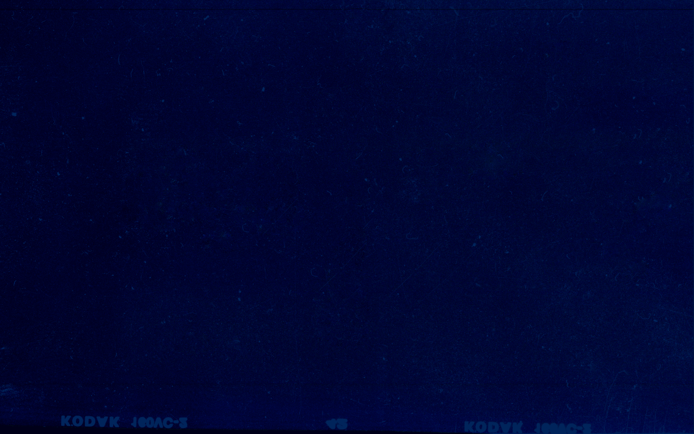

# Сложно сосредоточиться

https://github.com/Taaevmg/slozhno-sosredotochitsya-ad

Адаптивный одностраничный сайт с автоматическим переключением светлой и тёмной тем в зависимости от системных настроек пользователя. Проектная работа курса «Вёрстка» Яндекс Практикума.

## 🚀 Демо

[Открыть сайт →](https://Taaevmg.github.io/slozhno-sosredotochitsya-ad/)

## ✨ Особенности

- **Mobile first** — адаптивная вёрстка для мобильных, планшетов и десктопов
- **Две цветовые темы** — светлая и тёмная, с автоматическим определением системной темы
- **Ручное переключение темы** — кнопки «День / Авто / Неон» с сохранением выбора пользователя
- **Плавная типографика** — адаптивные размеры шрифтов через `clamp()`
- **Фиксированный фон** — фоновое изображение остаётся на месте при прокрутке
- **Семантическая разметка** — корректные теги `header`, `main`, `section`, `article`, `footer`
- **Доступность** — скрытие декоративных элементов от скринридеров через `aria-hidden`

## 🛠 Технологии

| Технология | Назначение |
|------------|------------|
| HTML5 | Семантическая разметка |
| CSS3 | Стилизация и адаптивность |
| CSS Grid | Раскладка блоков |
| CSS Custom Properties | Темы и переиспользуемые значения |
| `@media` queries | Адаптивность и `prefers-color-scheme` |
| `clamp()` | Плавная типографика |
| `background-attachment: fixed` | Фиксированный фон |
| JavaScript | Переключение